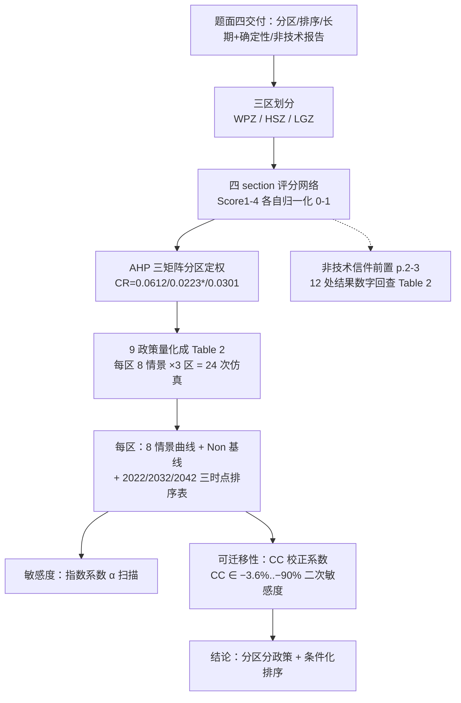

# 精读 02 · Reimagining Maasai Mara（2023 题 B O 奖 · 队伍 2300136 · Tsinghua University）

> 这份精读怎么用：这是一篇**"评价模型如何做成定量仿真"**的示范——AHP 不只是打分排序，而是与 24 次政策仿真、三时点排序表、可迁移性检验咬合成完整证据链。读它重点看三件事：① 评价模型怎么"参数化"（Table 2）；② 检验怎么"报数"；③ 它与同题 F 档论文的差值（[升档差值页](06_升档差值_2023B.html)）。配套：[模式卡片](05_卡片_2023B_Tsinghua.html)、[F 档对照卡](04_卡片_2023B_Fuzhou.html)、[05_评价与决策](../02_知识模块/05_评价与决策.html)。
> 页码均为论文 PDF 页码（页眉 Page N of 25 与 PDF 页码一致）。所有公式与矩阵为本精读作者亲读论文 p.15-17 抄录，审计数字已实跑验证（2026-11-22）。

## 0. 一分钟看懂全文骨架



**为什么这个骨架好**：它把"评价类题目最容易流于打分排序"的题型做成了**可仿真的政策实验**——AHP 定权只是起点，真正的证据在 24 次仿真 + 基线对照 + 三时点排序。VI 章的 CC 可迁移性检验直接回应题面 "applied to other wildlife management areas" 的原句，**题面每句话都有交付物**。*带 \* 的 CR=0.0223 见 §4 审计——印值与矩阵复算有偏差*。

## 1. 逐节导读

### Summary + 前置信件（p.1-3）——本篇最独特的动作
- 【它写了什么】题面要求的"两页非技术报告"没有放在文末，而是**前置为致肯尼亚旅游与野生动物委员会的两页信件**（p.2-3），内含 12 处结果数字（50%→2%→5%→30%→0.5%→5%→0.5%→10%→8%→0.5%→0.7%→USD$310），其中 11 处可逐条回查 Table 2（p.17）。
- 【为什么这样写】评委按序阅读的前 3 页就能完成"建议—数字—机制"三重交付。同题 F 队把海报放文末（F p.23-24），前 3 页可触达结果量值为 **0**——这是两篇最直观的差值（见[升档差值页](06_升档差值_2023B.html) 维度 5）。
- 【你要学什么】交付物的**位置本身就是设计变量**："把结果量值放到评委最先读的地方，并与参数表闭环"。

### §I-II Introduction + Foundations（p.5-7）
- 【它写了什么】Literary review 指出先前研究 survey-based 的缺口；6 条主假设逐条绑引文数字（85% household income [10]、25%/75% 土地占比 [11]）；符号表 26 项。
- 【你要学什么】文献综述写"别人没做什么"而不是"别人做了什么"——缺口即定位。

### §III Model Design（p.8-17，论文主体）
- 【它写了什么】四个 section（野生动物/自然资源/本地财务/旅游冲突）各自归一化成 0-1 分数；**每个 section 固定三段式：Modelling ideas → Supplementary assumptions → Calculations**（p.8-15）；AHP 三矩阵分区定权（p.15-16）；九政策量化成 Table 2（p.16-17）。
- 【为什么这样写】三段式节奏让"模型在思考"而不是"模型在执行"——每个建模动作先给直觉、再补假设、最后才算数。Table 2 把"政策"从文字变成参数百分比（如 ①"盗猎减 50%、野生动物年增 2%"），是全文的**参数枢纽**。
- 【你要学什么】① 评价模型的 section 化与归一化；② "政策→参数"映射表；③ 三段式写作节奏。

### §IV Results（p.18-20）
- 【它写了什么】每区一张 8 情景曲线图（含 Non 基线）+ 一张 2022/2032/2042 三时点排序表（Tables 3/4/5）；HSZ 冠军随时点变化如实展示。
- 【你要学什么】条件化结论的写法："best policy for most years"（p.1）+ 排序表——不硬造唯一冠军。

### §V-VI 敏感度 + 可迁移性（p.21-22）
- 【它写了什么】指数系数 α 扫描（六面板 3D）；VI 章 CC 校正系数把模型迁移到其他保护区，CC∈[−3.6%,−90%] 二次敏感度报 final score 稳定区间 0.5-0.575。
- 【你要学什么】可迁移性做成**定量检验**而不是一句"模型可推广"。

### §VII-IX + 附录（p.23-25）
- 【它写了什么】5 Strengths / 3 Weaknesses；22 条文献 3 条带 URL；无独立 AI 报告章（2023 年口径，对照 2024 E 卡的 AI Utilization Report）。
- 【你要学什么】读老论文要分"时代口径"与"今日可抄"——数字密度与 AI 披露按 2026 标准加码。

## 2. 图表深析

| 图 | 位置与作用 | 为什么这样画 |
|---|---|---|
| Fig 1（p.8） | 四 section 评分网络流程图，图内自带公式骨架 | 一图讲清"分数从哪来、相互作用箭头是什么"——信息密度高于常规流程图 |
| Fig 6（p.15） | 三土地类型实地图（Mara Triangle/Olare Orok 等实名标注） | 直接回应题面 "within and outside the current boundaries"——分区不是假设而是地图 |
| Fig 7（p.16） | 三区 × 四 section 权重堆叠条（带百分比标签） | AHP 结果的可视化；分区权重不同一目了然 |
| Fig 8-10（p.18-20） | 每区 8 情景曲线 + Non 基线 + 三时点排序表 | 反直觉结果（①单独施行负面）直接可见于曲线 |
| Fig 11（p.21） | 六面板 3D 柱状敏感度 | 覆盖广但轴标签过小数值难读——**O 论文也有图表瑕疵** |

**可运行复现**：审计论文 §3.1.5 的三张 AHP 矩阵——复算 CR 与特征向量权重，对照论文印值（CR=0.0612/0.0223/0.0301）与 Fig 7 堆叠条百分比（51/25/6/18、14/10/35/41、16/29/12/44）：

```python
import numpy as np

def ahp_cr(M):
    vals, vecs = np.linalg.eig(M)
    k = int(np.argmax(vals.real))
    lam = float(vals.real[k])
    w = np.abs(vecs[:, k]); w = w / w.sum()
    CI = (lam - len(M)) / (len(M) - 1)
    return lam, CI / 0.90, w * 100      # RI = 0.90 (n=4)，与论文一致

WPZ = np.array([[1,2,7,4],[1/2,1,3,2],[1/7,1/3,1,1/5],[1/4,1/2,5,1]], float)
HSZ = np.array([[1,1,1/2,1/3],[1,1,1/2,1/5],[2,2,1,1],[3,5,1,1]], float)
LGZ = np.array([[1,1/2,1,1/2],[2,1,3,1/2],[1,1/3,1,1/4],[2,2,4,1]], float)
fig7  = {"WPZ":[51,25,6,18], "HSZ":[14,10,35,41], "LGZ":[16,29,12,44]}
paper = {"WPZ":0.0612, "HSZ":0.0223, "LGZ":0.0301}

for name, M in (("WPZ",WPZ), ("HSZ",HSZ), ("LGZ",LGZ)):
    lam, cr, w = ahp_cr(M)
    print(name, "CR =", round(cr, 4), "(paper", str(paper[name]) + ")",
          "weights =", [round(v,1) for v in w], "(Fig7", fig7[name], ")")
```

预期输出（本站实跑验证，2026-11-22）：

```
WPZ CR = 0.0612 (paper 0.0612) weights = [51.4, 25.0, 6.1, 17.6] (Fig7 [51, 25, 6, 18])
HSZ CR = 0.0297 (paper 0.0223) weights = [13.7, 12.3, 30.9, 43.2] (Fig7 [14, 10, 35, 41])
LGZ CR = 0.0301 (paper 0.0301) weights = [15.6, 28.7, 11.7, 44.0] (Fig7 [16, 29, 12, 44])
```

读法：**WPZ 与 LGZ 精确复算通过**（权重与 Fig 7 在舍入内一致）；**HSZ 两处偏差**——CR 0.0297 vs 印值 0.0223、权重 12.3/30.9 vs Fig 7 的 10/35（偏差 2.3/4.1 个百分点，超出舍入）。矩阵本身互反性核对无误（row2 col4=1/5 ↔ row4 col2=5 等）。最可能的解释：印刷矩阵非计算所用矩阵，或 HSZ 用了不同优先级方法。结论不受影响（两个 CR 都 <0.1），但"印值与复算对账"这一步暴露了它——**这正是独立复现审计的价值**。

## 3. 公式逐条精讲

### AHP 特征向量法（p.15-16，论文 eq 未编号，矩阵即公式）
**怎么想到**：四 section 权重因土地类型而异（WPZ 重野生动物、LGZ 重畜牧）——分区建三个比较矩阵，避免"一套权重打天下"。
**完整推导**：比较矩阵 $A$（$a_{ij}$ = 因子 $i$ 对 $j$ 的偏好，互反性 $a_{ji}=1/a_{ij}$）→ 一致性时最大特征值 $\lambda_{max}=n$ → 权重 = $\lambda_{max}$ 对应特征向量归一化 → 一致性比率 $CR = \frac{\lambda_{max}-n}{(n-1)\cdot RI}$，$RI=0.90$（$n=4$）。以 WPZ 矩阵为例复算：$\lambda_{max}=4.1651$，$CI=0.0550$，$CR=0.0612$——与论文印值**逐位一致**。
**适用边界**：CR<0.1 只保证逻辑自洽不保证判断正确（[05_评价与决策](../02_知识模块/05_评价与决策.html) §1.4）；矩阵元素靠 1-9 标度拍出来时，权重敏感度扫描是必要的补充——**两篇论文都只报 CR 未做权重扰动**（O 卡缺项诚实登记）。

### Score4：旅游冲突评分（p.15）
**怎么想到**：游客与野生动物的"有害相遇"用 PIE 相遇概率（改自 Berger & Cunningham：$p \approx 2TN/(T+N)^2$），冲击强度 λ/σ 归一化后为常数。
**完整推导**：$\text{Score}_4 = \frac{(1-\lambda)+(1-\sigma)}{2}$——冲突因子 λ、疾病因子 σ 各取"1 减"后取平均：**因子越大、分数越低**，与其他三个"越大越好"的 section 天然反向，归一化后统一成 0-1。
**适用边界**：λ/σ 的归一化基准论文未展开（β/γ 分量数值未列出——O 卡诚实登记）；普通队可补一个基准敏感性说明。

### CC 校正系数（p.22，VI 章核心）
**怎么想到**：题面要求模型可迁移——把"新保护区参数 = 原 Mara 参数 × (1+CC)"作为桥梁，CC 扫一遍就成了迁移检验。
**完整推导**：对任意新保护区，参数 $p' = p(1+CC)$；对 CC∈[−3.6%,−90%] 扫描，报 final score 稳定区间 0.5-0.575。**把"可推广"从一句声明变成一条可复核的数值曲线**——这是全文最值得抄的检验设计（对照 [06_蒙特卡洛与模拟](../02_知识模块/06_蒙特卡洛与模拟.html) 的参数扫描纪律）。
**适用边界**：CC 单参数缩放假设"新保护区与原 Mara 只差一个比例因子"——结构差异（不同物种、不同政策集）不在其中，声明适用范围时要诚实。

## 4. 建模决策链 + 独立复现审计

| 决策 | 作者的选择 | 被放弃的替代 | 为什么 |
|---|---|---|---|
| 三问结构 | 一个评分网络贯穿 | 三问三模型 | 评委理解一次，三问复用（同 [2024 E 卡](01_卡片_2024E_Soochow.html) 打法 1，跨题稳定） |
| 非技术报告位置 | **前置 p.2-3 信件** | 文末海报（同题 F 队的选择） | 评委前 3 页即触达 12 处结果数字 |
| 分区权重 | 三矩阵分区 AHP | 全区一套权重 | 土地类型功能不同（p.15 论述） |
| 政策效果来源 | Table 2 设定百分比 | 文献估计 | **弱点**：p.18 自认 "extremely dependent upon our predetermined parameter"——设定值要有出处或做敏感度，本文做了 α/CC 敏感度部分补救 |
| 可迁移性 | CC 校正系数定量检验 | 一句声明 | 题面原句的直接交付 |

**独立复现审计汇总**（复现代码见 §2）：

| 审计项 | 结果 | 判定 |
|---|---|---|
| WPZ 矩阵 CR | 复算 0.0612 = 印值 | ✓ 逐位一致 |
| WPZ 权重 vs Fig 7 | 51.4/25.0/6.1/17.6 vs 51/25/6/18 | ✓ 舍入内一致 |
| LGZ 矩阵 CR | 复算 0.0301 = 印值 | ✓ 逐位一致 |
| LGZ 权重 vs Fig 7 | 15.6/28.7/11.7/44.0 vs 16/29/12/44 | ✓ 舍入内一致 |
| **HSZ 矩阵 CR** | **复算 0.0297 vs 印值 0.0223** | ⚠ 偏差 0.0074 |
| **HSZ 权重 vs Fig 7** | **12.3/30.9 vs 10/35** | ⚠ 偏差 2.3/4.1 个百分点 |
| 信件 12 处数字回查 | 11 处对应 Table 2；USD$310 与正文 247.74 USD 未互证 | ⚠ 一处待证 |

**审计结论**：三张矩阵两张全对、一张（HSZ）在 CR 与权重上双重偏离印刷值——矩阵互反性无误，故最可能是"印刷矩阵 ≠ 计算矩阵"。两个 CR 均 <0.1，结论稳健性不变；但普通队应学到：**定稿前把"印出来的矩阵"重算一遍 CR 是零成本动作**（对照 2024 E 精读的 Table 4 权重凑整发现——两篇 O 论文的数字自洽性都栽在小处）。

## 5. 从本篇提炼的可复用模板

**评价类论文结构模板**：

```
Summary（六要素）
非技术报告（前置！结果量值 + 参数表闭环）
I Introduction（文献缺口 = 你的定位）
II Assumptions（每条绑引文数字）+ Nomenclature
III Model Design
    3.1 各 section：三段式（Ideas → 增补假设 → Calculations）
    3.2 政策→参数映射表（Table 2：每条政策 = 若干个 ±X%）
IV Results：每区 情景曲线（含基线）+ 三时点排序表
V Sensitivity（系数扫描）
VI Transferability（可迁移性做成定量检验）★本篇独创
VII-VIII S&W + Conclusions
References（3 条带 URL）
```

**句式库**（完整 7 条见[模式卡片](05_卡片_2023B_Tsinghua.html)）：
- 摘要验证句：`To minimize error through errant parameters, we apply random residuals... to capture unobserved heterogeneity`（p.1）
- 政策时间尺度句：`restricting tourism quickly produces salutary results until 2030 but slowly declines...`（p.18——把曲线形状翻译成决策语言）
- 诚实质疑句：`this result is extremely dependent upon our predetermined parameter`（p.18——对自家反直觉结论主动标注）
- 不可量化价值句：`the benefits... go beyond measurable numbers and that it is vital in building the trust`（p.3——分数没赢但政策仍推荐）

**图表配方**：评分网络流程图（带公式骨架）→ 三区实地图（回应题面空间限定词）→ 权重堆叠条 → 情景曲线+基线 → 三时点排序表 → 3D 敏感度（注意轴标签可读性）→ CC 迁移曲线。

---

建议对照：[04_卡片_2023B_Fuzhou](04_卡片_2023B_Fuzhou.html)（同题 F 档）、[06_升档差值_2023B](06_升档差值_2023B.html)（八维度对照）、[05_评价与决策](../02_知识模块/05_评价与决策.html)（AHP/CR 纪律）。
