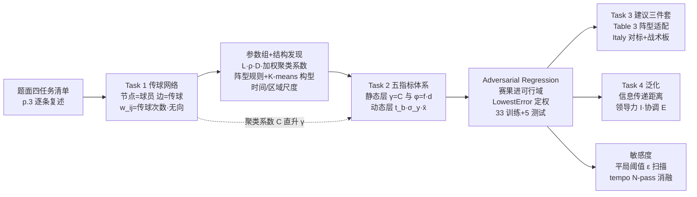

# 精读 03 · Teaming Wisdom Coming from Soccer Field（2020 题 D O 奖 · 队伍 2006782 · Xidian University 西安电子科技大学 / INFORMS Award）

> 这份精读怎么用：把一篇网络科学题 O 论文当作**一条流水线**读——题面动词翻译成图定义表，图统计量直升成指标体系，评价模型把赛果写进搜索可行域，建议层再落回数字表与战术板。读完你应该能回答两个问题：网络题从 Task 1 的图走向 Task 2 的指标体系，最短路径是什么；以及"约束搜索式评价模型"怎么搭、怎么命名、怎么审计它。配套：[模式卡片](03_卡片_2020D_XJTU.html)（拆解者视角结构表）、[D 题打法](../03_题型打法/D_运筹网络.html)、[04_图论与网络](../02_知识模块/04_图论与网络.html)。
> 页码均为论文 PDF 页码 p.1–27（页脚印刷页 "Page X of 25" = PDF − 2）；全部直接引语与瑕疵逐条对 LaTeX 源码（`2006782.tex`）核验；§2 复现代码与 §4 审计数字本站实跑验证（2026-11-22）。
> **年代口径（单独标注）**：2020 年赛制 25 页含附录、无 AI 使用披露要求；本篇 Summary 全篇零结果数字（p.1）是 2020 年普遍口径而非该队失误——凡涉及此差异处均单独标注，不与 2026"数字优先"标准混写。

## 0. 一分钟看懂全文骨架



**为什么这个骨架好**：一张网络贯穿四问——Task 1 的加权聚类系数直接升格为 Task 2 的 γ 指标（虚线边），评价模型搜出的权重又反哺 Task 3 的建议排序。评委理解一次"网络语言"，后面三问只看增量，普通队最容易犯的"每问另起炉灶"被结构性避免。副线也各司其职：敏感度只管两个"拍脑袋参数"（平局阈值 ε、tempo 的 N-pass 球数），Task 4 只做概念外延，不抢主线戏；全文记忆点则是那个起了专名的自定义评价模型——"Adversarial Regression + LowestError"在摘要-正文-代码三处一致（p.1 / p.13-15 / p.27）。

## 1. 逐节导读

### Summary（p.1）
- 【它写了什么】立论句开场（"Team success is much more than the sum of the abilities of individual players."，p.1，14 词）→ 四个 TASK 各一段、与题面任务一一对应 → 敏感度与优缺点各一句收尾；关键词三个（Passing network / Adversarial Regression / Defensive Counterattack）。
- 【为什么这样写】四问四段是"任务对账式摘要"：评委拿题面逐条对账，每问都能找到落点。专名机制（"we choose the weight with LowestError as the regression equation"，p.1，10 词）让自定义方法有了可引用的名字。⚠ 年代口径：全篇零结果数字——按 [07_写作与SummarySheet](../02_知识模块/07_写作与SummarySheet.html) §1.2 的"数字优先"标准是明显缺口，但这是 2020 年普遍口径而非该队失误。
- 【你要学什么】任务对账结构 + 专名贯穿是跨年代都成立的动作；数字锚点按 2026 标准加码执行（详见卡片对照 3）。

### §1-2 Introduction + Preparation（p.3-4）
- 【它写了什么】1.1 用四条 bullet 逐条复述题面任务清单（建网络+多尺度 / 识别指标 / 给教练建议 / 如何组队）；1.2 Our Work 四步流水；2.1 假设 4 条（网络是无向图；换人直接替换、不改变阵型；对手强度水平无差异；各球员身体素质与个体能力相同）；2.2 符号表 15 项（Table 1）。顺带一提：1.2 里 "K-means agAlgorithmm"（p.3，tex L101）是拼写瑕疵——O 论文也有，教训只是定稿前通读。
- 【为什么这样写】假设每条都喂给后面的模型：假设 1 → eq(1) 的 w_ij=w_ji（正文 p.5 重申）；假设 2 → 3.2.1 阵型识别因此可以只查首发名单；假设 3、4 为"只看传球结构、不建个体差异"的简化立场背书。**假设表是地基，不是仪式**。任务清单复述则是全文对账的靶子——后文题面每个状语都对应一节一图。
- 【你要学什么】"假设-模型"配对法：写每条假设时自问"它支撑哪一段模型"；题面任务清单复述=给评委一张对账表。

### §3 Task 1：Ball Passing Network Model（p.4-10，全文地基）
- 【它写了什么】3.1.1 用半页完成翻译：节点=球员、边=传球事件、权=传球次数 w_ij（eq(1) 邻接矩阵，无向，Fig 1 Gephi 可视化）；3.1.2 四参数逐个给定义式——L（eq(2)）、ρ（eq(3)）、直径 D（eq(4)-(5)，拓扑距离=权重倒数）、加权聚类系数（eq(6)-(7)），每个参数后接一句足球语义（degree 高=更多参与进攻、小直径=传球分散），Match 1 数值 L=369、ρ=6.71（p.8）；3.2.1 阵型规则映射（4-3-3/5-3-2/4-4-2）；3.2.2 结构发现三段式：拓扑距离矩阵热图目视找小值（Fig 2，p.7）→ K-means 聚类画回场地（Fig 3，p.8，1 个 dyad + 2 个 triad）→ 定量复核（"the cluster coefficient C of the three equals 7.31, much smaller than that of the whole team (7.62)"，p.8，18 词；trio 触达传球 227 次）；3.3 题面状语"regions and time"拆成两节：时间尺度（10-min 传球数 Fig 4 + 整场/整季快照 Fig 5，p.9-10）与区域尺度（8 区域热图 Fig 6，p.10）。
- 【为什么这样写】参数组=定义式+语义翻译，评委不懂图论也能读；三段式让聚类从黑箱变成可验证的发现；"题面状语→节-图对账"保证交付物一个不漏。
- 【你要学什么】网络题开局 2 小时的产出就是那张"节点边权定义表+方向性声明"（与 [04_图论与网络](../02_知识模块/04_图论与网络.html) §1.1 心法一致）；结构发现不要只报算法输出，补一层定量复核。

### §4 Task 2：Evaluation of Successful Teamwork（p.11-16，主模型战场）
- 【它写了什么】4.1 指标体系两层：静态层 γ=聚类系数 C（图统计量直升）+ φ=f·d（进球率 eq(8) × 防守率 eq(9)，φ=eq(10)）；动态层 tempo t_b=50-pass time（出自文献[6]，p.12）、灵活性 σ_y（eq(11)）、压迫 x̄（eq(12)，阈值 50）。4.2 Adversarial Regression 四步（p.13）：线性评分 eq(13) → 胜 S₁>S₂ / 负 S₁<S₂ / 平 |S₁−S₂|<1 的赛果约束 → 收集全部可行权重 → 取 Huskies 得分方差最小者为回归方程（LowestError）；命名卖点句："introduce the opponent's confrontation factors, which makes the model more fair in evaluation"（p.13，13 词）。4.3 应用（p.13-15）：33 场训练（31/33 场人工调整以斜体标注、32 场剔除、零均值单位方差标准化——Table 2 脚注 p.14）+ 末 5 场测试；网格搜出 20 组可行权重（Fig 9，p.14），最终权重 (0.4, 0.6, 0.2, 0.1, 0.1)、lowestError=0.071（eq(14)-(15)，p.15）；测试结论只有一句 "we can conclude that the model is valid"（p.14，8 词）——无准确率数字。4.4 Discussion（p.15-16）：对手反制会改变指标值，策略非普遍有效（Fig 10：9 场对手 pressing 全程高于 Huskies）。
- 【为什么这样写】指标体系从网络模型里"长"出来而非另起炉灶（C→γ 是最短路径）；评价模型不引入任何 ML 黑话——把赛果写成硬约束、在可行域里定权，既解决了"没标签怎么训练"，又让对手因素进模型；4.4 的讨论把"策略依赖对手"写成模型性质，为 Task 3 的防守反击建议铺路。
- 【你要学什么】图统计量直升指标骨架；"约束写进可行域+给方法起专名"的写作动作；数据清洗披露的脚注做法；以及反面教材——样本外测试必须报数字（2026 口径）。

### §5 Task 3：Advice on Improving Team Success（p.16-19）
- 【它写了什么】赛季战绩 13 胜 15 负 10 平（p.16）；Table 3 三阵型 × 三指标（5-3-2 协调 7.5032、压迫 49.67 最高，灵活性 23.50 最低）→ 最适 5-3-2 → 防守反击；5.2 自补 Italy 2012 欧洲杯半决赛数据（引文献[7]）画八项对比条形图（Fig 11，p.17：协调 14.39 vs 5.37、控球率 43.8% vs 27.4% 等）；5.3 三条 Change（主阵 4-1-3-2 可变阵 5-3-2/4-3-3；核心球员 M2/F1/F2；攻防连贯）+ Fig 12 战术板（p.18，白虚线跑位/红实线进攻传球/黄实线防守传球，图例在正文）。小结句式："gap with the strong teams is mainly reflected in Coordination, Flexibility and Pressing"（p.1，12 词）。
- 【为什么这样写】建议层三件套——每条建议都有支撑：数字表（Table 3）、对标图（官方数据不够就自补外部数据）、战术板（接近"教练能执行"的交付物）。
- 【你要学什么】建议必须落在指标名和数字上，不写口号；外部对标数据要给出处（文献[7]）。小瑕疵顺带记一笔：§5.3 标题 "Advise on next Season" 应为 Advice（p.18，tex L749）。

### §6 Task 4：How to Design more Effective Teams（p.19-20）
- 【它写了什么】概念映射三组：协调→信息传递距离 d（Fig 13，A→B 距离 1、A→C 距离 3）；贡献分配→按岗位分别定量化规则；灵活性→协调标准差/不同方案人数的标准差；6.2 补领导力强度 I=Σ1/d_N（eq(16)）与有效协调 E=Σt_work/t_total（eq(17)）。全程无量化验证，且作者自认泛化指标"难以量化，说服力低"（Weaknesses，p.22）。
- 【为什么这样写】泛化只做"指标类比"而非重跑模型——这是全文最薄的一章，但作者把它诚实地登记进 Weaknesses，不硬撑。
- 【你要学什么】泛化题的最低合格线=概念映射+诚实登记；有余力的队应当把泛化指标在一个真实小案例上算出来，这一步就是普通队与 O 队在 Task 4 的分野。

### §7 敏感度 + §8 S&W + 附录（p.20-27）
- 【它写了什么】7.1 平局阈值 ε∈[0,2] 扫描（Fig 14，p.21）：ε<1 时五指标权重混沌、ε≥1 稳定，ε=1/1.5/1.8 合理，自曝 "So our model is more sensitive to the situation of a draw"（p.21，12 词）；7.2 tempo 的 N-pass 消融（10/30/50/70/90 球，Fig 15，p.21-22）：30-pass 锯齿、70-pass 平坦，"This is why the 50-pass time is the most scientific and reasonable to calculate tempo"（p.22，15 词）。8 优缺点各 2-3 条；References 9 条（[2][6][8] 为足球网络分析文献）；附录 MATLAB×2 + Python×1 与正文方法一一对应（p.24-27）。
- 【为什么这样写】两个敏感度都瞄准"人为设定的自由参数"而非常规权重扰动——直接回应"结论是不是参数巧合"，比泛泛扰动更让评委信服；附录代码让"可复核"落地（尽管有瑕疵，见 §4 审计）。
- 【你要学什么】敏感度选题=找模型里"拍脑袋"的参数扫一遍；附录代码是可复核性的最低配置——但要与正文符号对齐（本篇 pho 行就是一个反例，见 §4）。

## 2. 图表深析

| 图 | 位置与作用 | 为什么这样画 | 怎么画出来 |
|---|---|---|---|
| Fig 2（p.7） | Match 1 拓扑距离矩阵热图，红框标出小距离节点对=候选簇，∞=无传球 | 把"谁和谁抱团"从网络图上目视变成矩阵上查数——算法运行前的证据层 | eq(4) 逐对算 1/w_ij → 11×11 热图+红框标注 |
| Fig 3（p.8） | K-means 结果画回场地：1 个 dyad + 2 个 triad | 聚类落回物理空间，教练能直接看懂"哪几个人是一伙的" | 对拓扑距离矩阵聚类 → 场地摆位图着色 |
| Fig 4（p.9） | 10-min 传球数节奏曲线+三次换人事件标注 | 把"节奏"翻译成曲线，归因（约 30min 提速、末段保守）挂在事件上 | 时序面积图+时间轴事件标签 |
| Fig 6（p.10） | 传球位置热图：后场最热、防线连通高于锋线、边路浅色 | 一张图同时给攻防倾向与改进方向（边路利用不足）——给 Task 3 留钩子 | 场地 8 等分 → 传球位置密度热图 |
| Fig 9（p.14） | 20 组可行权重的 LowestError 折线，标注最优 (0.4,0.6,0.2,0.1,0.1) 与 0.071 | 把约束搜索的黑箱摊开成一条线：可行集真实存在且可选优 | 穷举可行权重 → 逐组算方差 → 折线+虚线基准 |
| Fig 12（p.18） | 防守反击战术板：4-1-3-2 可变阵，白虚线跑位/红实线进攻传球/黄实线防守传球 | 建议层的可视化交付物，比文字更接近"能执行的东西" | 战术板绘制；图例放正文（图内拥挤度的取舍） |

**可运行复现**：下面的代码复现本精读的"独立复现审计"——全部输入取自论文印刷值：从 Fig 2（p.7）逐格誊读 Match 1 的 11×11 拓扑距离矩阵重建权重网络，复算 ρ 与加权聚类系数对照论文印值（L=369、ρ=6.71、C=7.62、trio 7.31），审计 σ_y 印刷式（eq(11)，p.12），复演 Adversarial Regression 约束搜索（Table 2 可见 7 行，p.14），并核对直径实现与附录代码的落差（英文标签避免字体问题）：

```python
# -*- coding: utf-8 -*-
# 2020 ICM D（队伍 2006782）独立复现审计：全部输入取自论文印刷值
import numpy as np
import matplotlib
matplotlib.use("Agg")
import matplotlib.pyplot as plt
from itertools import product

# ---------- A. 从 Fig 2(p.7) 逐格誊读 Match 1 的拓扑距离矩阵，重建权重矩阵 ----------
players = ["G1","D1","D2","D4","D3","M1","M2","M3","F1","F2","F3"]; n = len(players)
INF = np.inf
Dmat = np.array([          # d_ij = 1/w_ij（对称；对角与"无传球"= INF）
    [INF, 1/4, 1/3, INF, 1/8, 1/4, 1,   INF, 1/2, INF, INF],   # G1
    [1/4, INF, 1/29,1,  1/14,1/24,1/2, 1/10,1/5, 1/6, 1  ],    # D1
    [1/3, 1/29,INF, 1,  1/24,1/10,1/2, 1/11,1/3, 1/15,1  ],    # D2
    [INF, 1,  1,   INF, 1/13,1/4, 1/10,1/4, 1,   1/4, 1/2],    # D4
    [1/8, 1/14,1/24,1/13,INF, 1/4, 1/8, 1/14,1,  1/6, 1/3],    # D3
    [1/4, 1/24,1/10,1/4, 1/4, INF, 1/5, 1/17,1/6, 1/24,1/3],   # M1
    [1,   1/2, 1/2, 1/10,1/8, 1/5, INF, 1/13,1,  1/4, 1/6],    # M2
    [INF, 1/10,1/11,1/4, 1/14,1/17,1/13,INF,INF, 1/10,1/3],    # M3
    [1/2, 1/5, 1/3, 1,   1,   1/6, 1,   INF,INF, 1/8, INF],    # F1
    [INF, 1/6, 1/15,1/4, 1/6, 1/24,1/4, 1/10,1/8, INF, 1/7],   # F2
    [INF, 1,   1,  1/2, 1/3, 1/3, 1/6, 1/3, INF, 1/7, INF]])   # F3
w = np.where(np.isinf(Dmat), 0.0, 1.0/np.where(np.eye(n, dtype=bool), 1.0, Dmat))
np.fill_diagonal(w, 0.0)

L = w.sum()/2
print("== A. L / rho ==")
print("L_recon = %.0f  (paper 369, diff %.1f%%)" % (L, abs(L-369)/369*100))
print("rho = 2L/(n(n-1)), n=11: recon %.3f | paper-L %.3f (paper prints 6.71)" %
      (2*L/(n*(n-1)), 2*369/(n*(n-1))))

# ---------- B. 加权聚类系数 eq(6)-(7)：Cw(i)=sum_jk w_ij w_jk w_ik / sum_jk w_ij w_ik ----------
deg = w.sum(axis=1)
Cw = np.einsum("ij,jk,ik->i", w, w, w) / deg**2     # 分母 = 度平方（对角已置零）
print("\n== B. weighted clustering ==")
print("per player:", {players[i]: round(float(Cw[i]), 2) for i in range(n)})
print("C_team_recon = %.3f (paper prints 7.62)" % Cw.mean())
i = players.index("D1")                              # 语义恒等式：Cw(i) = 邻居对权重的加权平均
pw = np.array([w[j,k] for j in range(n) for k in range(n) if j!=i and k!=i])
pc = np.array([w[i,j]*w[i,k] for j in range(n) for k in range(n) if j!=i and k!=i])
print("identity check: Cw(D1)=%.4f == weighted mean of w_jk = %.4f" %
      (Cw[i], (pw*pc).sum()/pc.sum()))
trio = [players.index("D1"), players.index("M1"), players.index("F2")]
wt = w[np.ix_(trio, trio)]
print("trio (D1,M1,F2): unique passes touching trio = %d (paper prints 227) ; "
      "members' full-network Cw mean = %.3f / subgraph mean = %.3f (paper prints 7.31)" %
      (deg[trio].sum() - wt.sum()/2, Cw[trio].mean(),
       (np.einsum("ij,jk,ik->i", wt, wt, wt)/wt.sum(axis=1)**2).mean()))

# ---------- C. sigma_y eq(11) 印刷式审计 ----------
print("\n== C. sigma_y eq(11) ==")
rng = np.random.default_rng(7); y = rng.uniform(50, 100, 40)
print("printed (1/n)sum(y_j-ybar) = %.2e  (identically 0 for ANY data)" % np.mean(y-y.mean()))
print("np.std = %.2f ; mean|y-ybar| = %.2f ; Fig 7 prints 33.70 / 26.66 (std upper bound on [50,100] = 25)" %
      (y.std(), np.abs(y-y.mean()).mean()))

# ---------- D. lowestError：正文称 standard deviation，代码返回 np.var ----------
s = np.array([155.8, 120.3, 98.6, 102.1, 131.7, 109.4])
print("\n== D. lowestError ==  np.var = %.3f ; np.std = %.3f" % (np.var(s), np.std(s)))

# ---------- E. Adversarial Regression 流程复演（Table 2 可见 7 行，p.14）----------
print("\n== E. constraint search ==")
H = np.array([[7.61,62.25,539.50,32.42,42.37],[2.88,28.71,1019.95,29.30,46.36],
              [5.10,8.43,634.78,27.77,40.43],[6.01,6.14,760.01,32.74,44.14],
              [5.61,62.25,707.96,30.94,50.75],[6.58,20.10,986.98,32.53,44.20],
              [3.75,39.83,1159.30,29.43,51.34]])
O = np.array([[4.00,12.60,1476.57,28.58,51.23],[8.25,11.17,692.49,27.34,49.81],
              [9.00,34.17,596.98,27.03,52.02],[5.66,62.40,934.64,31.94,51.62],
              [3.00,7.13,2018.52,30.18,58.75],[4.21,13.87,1014.37,26.66,50.13],
              [3.35,21.90,479.62,27.61,51.20]])
res = np.array([1,1,-1,-1,1,1,0])                     # win win loss loss win win tie
mu, sd = np.vstack([H,O]).mean(axis=0), np.vstack([H,O]).std(axis=0)   # 合并 z-score（近似归一化）
Hn, On = (H-mu)/sd, (O-mu)/sd
G = np.array(list(product(range(1,10), repeat=5)))*0.1                  # 9^5=59049，步长 0.1，同附录代码
ok = ((res==1)&(G@Hn.T >= G@On.T)) | ((res==-1)&(G@Hn.T <= G@On.T)) | \
     ((res==0)&(np.abs(G@Hn.T - G@On.T) <= 1))
feas = ok.all(axis=1)
print("grid 9^5 = %d combos; feasible on all 7 printed rows: %d" % (len(G), feas.sum()))
wf = np.array([0.4,0.6,0.2,0.1,0.1])
hit = np.where((np.abs(G-wf)<1e-9).all(axis=1))[0][0]
print("paper weights feasible on 7 rows = %s ; per-match satisfied = %s" %
      (bool(feas[hit]), ok[hit].tolist()))
fv = np.array([np.var(Hn@g) for g in G[feas]])
print("argmin-var feasible weights (7 rows):", G[feas][fv.argmin()], "var=%.4f" % fv.min())

# ---------- F. 直径：正文称 geodesic，附录代码只取直连边的 max 1/w ----------
import scipy.sparse.csgraph as csg
dist = np.where(w > 0, 1.0/np.where(w > 0, w, 1), np.inf); np.fill_diagonal(dist, 0.0)
dsp = csg.dijkstra(csg.csgraph_from_dense(dist, null_value=np.inf), directed=False)
print("\n== F. diameter ==  code semantics max direct-edge 1/w = %.3f ; "
      "true geodesic diameter = %.3f" % (1/w[w>0].min(), np.nanmax(np.where(np.isfinite(dsp), dsp, np.nan))))

# ---------- 三面板审计图 ----------
fig, axes = plt.subplots(1, 3, figsize=(15, 4.6))
ax = axes[0]
pos = {"G1":(4,50),"D1":(18,70),"D2":(18,56),"D3":(18,42),"D4":(18,28),
       "M1":(40,64),"M2":(40,50),"M3":(40,36),"F1":(62,64),"F2":(62,50),"F3":(62,36)}
col = {"G":"#4C72B0","D":"#55A868","M":"#8172B2","F":"#DD8452"}
for i in range(n):
    for j in range(i+1, n):
        if w[i,j] > 0:
            (x1,y1),(x2,y2) = pos[players[i]], pos[players[j]]
            ax.plot([x1,x2],[y1,y2], color="#999999", zorder=1,
                    lw=0.4+w[i,j]/5.5, alpha=0.35+min(w[i,j]/29,1)*0.45)
for p,(x,y_) in pos.items():
    ax.scatter(x, y_, s=340, c=col[p[0]], edgecolors="white", zorder=3)
    ax.text(x, y_, p, ha="center", va="center", fontsize=7.5, color="white",
            fontweight="bold", zorder=4)
ax.set_title("rebuilt Match-1 network (Fig 2, p.7)\nL=%.0f vs printed 369; rho=%.2f vs printed 6.71"
             % (L, 2*L/(n*(n-1))), fontsize=9)
ax.set_xlim(0,72); ax.set_ylim(14,82); ax.axis("off")
ax = axes[1]
ax.bar(range(n), Cw, color=["#c44e52" if i in trio else "#4C72B0" for i in range(n)])
ax.axhline(Cw.mean(), color="k", lw=1, label="team mean C = %.2f" % Cw.mean())
ax.axhline(7.62, color="#55A868", ls="--", lw=1, label="paper prints 7.62")
ax.axhline(7.31, color="#c44e52", ls=":", lw=1.2, label="paper trio 7.31")
ax.set_xticks(range(n), players, fontsize=8); ax.set_ylabel("Cw(i), eq(6)")
ax.legend(fontsize=7.5); ax.set_title("weighted clustering per player (trio in red)", fontsize=9)
ax = axes[2]
vals = [abs(np.mean(y-y.mean())), y.std(), np.abs(y-y.mean()).mean()]
ax.bar(["printed eq(11)","np.std","mean|y-ybar|"], vals, color=["#c44e52","#4C72B0","#8172B2"])
for k,v in enumerate(vals): ax.text(k, v+0.4, "%.2f"%v, ha="center", fontsize=9)
ax.set_title("sigma_y audit on synthetic y in [50,100]\nprinted formula is identically 0", fontsize=9)
fig.tight_layout(); fig.savefig("audit_2020D.png", dpi=110)
print("\nfigure saved: audit_2020D.png")
```

预期输出（本站已实跑验证，2026-11-22）：

```
== A. L / rho ==
L_recon = 362  (paper 369, diff 1.9%)
rho = 2L/(n(n-1)), n=11: recon 6.582 | paper-L 6.709 (paper prints 6.71)

== B. weighted clustering ==
per player: {'G1': 9.2, 'D1': 8.39, 'D2': 8.24, 'D4': 6.55, 'D3': 6.65, 'M1': 6.84, 'M2': 6.38, 'M3': 8.66, 'F1': 9.87, 'F2': 7.26, 'F3': 7.62}
C_team_recon = 7.788 (paper prints 7.62)
identity check: Cw(D1)=8.3906 == weighted mean of w_jk = 8.3906
trio (D1,M1,F2): unique passes touching trio = 227 (paper prints 227) ; members' full-network Cw mean = 7.498 / subgraph mean = 6.120 (paper prints 7.31)

== C. sigma_y eq(11) ==
printed (1/n)sum(y_j-ybar) = 0.00e+00  (identically 0 for ANY data)
np.std = 14.76 ; mean|y-ybar| = 12.59 ; Fig 7 prints 33.70 / 26.66 (std upper bound on [50,100] = 25)

== D. lowestError ==  np.var = 384.769 ; np.std = 19.616

== E. constraint search ==
grid 9^5 = 59049 combos; feasible on all 7 printed rows: 203
paper weights feasible on 7 rows = False ; per-match satisfied = [True, False, True, True, True, True, False]
argmin-var feasible weights (7 rows): [0.1 0.1 0.1 0.3 0.1] var=0.1263

== F. diameter ==  code semantics max direct-edge 1/w = 1.000 ; true geodesic diameter = 0.376

figure saved: audit_2020D.png
```

读法：**左图**——誊读 Fig 2 重建的 11 人传球网络里，最粗的边正是论文识别的 trio 内边（D1–M1=24、M1–F2=24 传）与 D1–D2=29；L=362 vs 印刷 369（1.9%，人工誊读误差量级），而 trio 触达传球数 **227 与论文逐位一致**——誊读矩阵基本正确。**中图**——全队 C=7.79 vs 印刷 7.62（2.2%，同一誊读误差量级）；trio 成员（红柱）全网络 Cw 均值 7.50 与论文 7.31 同量级，而"子图内均值"口径只有 6.12——论文的"簇系数"口径应是前者；同时恒等式检验坐实了 eq(6) 的语义：Cw 就是"邻居间传球数的加权平均"，不是 0-1 概率，这解释了全文 C 值都在 6-10 之间。**右图**——印刷式 eq(11) 对任意数据恒等于 0（数学恒等式），np.std=14.76 才可能是 Fig 7 的 33.70/26.66 的来源。**复演 E**——7 行可见数据的近似归一化下可行权重 203 组、argmin-var 是 (0.1,0.1,0.1,0.3,0.1)，论文权重有 2 场不满足约束；**不能据此判论文有误**（33 场归一化参数未披露、人工调整值只有部分可见），但它暴露了方法的软肋：平局阈值 1 是绝对量，整套可行域绑定在归一化尺度上。绘图设计决策：三面板对应三类审计（结构重建/公式语义/公式勘误），左图边宽∝权复刻论文 Fig 1 的编码，中图三条参考线把"复算 vs 印刷"放进同一坐标系，右图把"恒为零"画成 0 高度的柱——**审计图的价值在让矛盾自己显形**。

## 3. 公式逐条精讲

### eq(6)-(7)：加权聚类系数（p.6）
**怎么想到**：无权聚类系数只数"队友是否相连"，但传球网络的边权差异巨大（29 传 vs 1 传）——"队友之间是否也互相连"必须用权重衡量。
**完整推导**：$C_w(i)=\dfrac{\sum_j\sum_k w_{ij}w_{jk}w_{ik}}{\sum_j\sum_k w_{ij}w_{ik}}$（eq6），全队取平均 $C=\frac{1}{n}\sum_i C_w(i)$（eq7）。关键观察：对角置零后**分母恰为度平方**——$\sum_{j,k} w_{ij}w_{ik}=(\sum_j w_{ij})^2=\deg(i)^2$，于是 $C_w(i)$ 是"以 $w_{ij}\cdot w_{ik}$ 为权、$i$ 的队友对之间传球数 $w_{jk}$ 的加权平均"。这解释了论文里 C=7.62/7.31 这类大于 1 的取值：它根本不是正文所说的"可能性"（"measure the possibility"，p.6），而是带权平均传球量。数值对账（本站实跑）：重建图 $C_{team}=7.79$ vs 印刷 7.62（誊读误差 ~2%）；$C_w(\text{D1})=8.3906$ 与"加权平均"恒等式逐位一致。
**适用边界**：值域不封顶，只能作同队跨场次的相对比较（论文 Fig 5 的用法正是如此）；孤立点与度为 1 的节点分母为零，需单独处理——论文未讨论。

### eq(11)：σ_y——tex 漏平方的发现（p.12）
**怎么想到**：灵活性=进攻路线的横向分散程度 → 用传球事件 y 坐标的标准差度量，σ_y 越大说明"能从两翼和中路多向进攻"。
**完整推导**：正确式（正文自称 standard deviation）应为 $\sigma_y=\sqrt{\frac{1}{n}\sum_{j=1}^{n}(y_j-\bar y)^2}$；论文印式（tex L492 / PDF p.12）却是 $\sigma_y=\frac{1}{n}\sum_{j=1}^{n}(y_j-\bar y)$——**漏了平方与开方**。而 $\sum(y_j-\bar y)\equiv 0$ 是数学恒等式：印刷式对**任何**数据恒等于 0（实跑输出 `0.00e+00`），Fig 7 的 33.70/26.66（p.12）证明实算不可能是它。更进一步：33.70 超过了半场坐标 [50,100] 上标准差的理论上界 25——实算口径大概率是全场坐标（推断，文中未说明，读不出处留空）。
**适用边界**：勘误不影响 σ_y 作为指标的合理性，只影响可复现性。教学价值在于把"符号写对"变成可机械执行的检验：**任何"离差和"式的公式，代入任意数据必得 0，一条 if 就能查出来**。

### eq(13) + Steps 1-4：Adversarial Regression 约束搜索（p.13-15）
**怎么想到**：评价模型最怕"自己给自己打分"——把两队赛果（胜/负/平）当硬约束，让数据替权重说话；对手因素由此进入评价体系（"introduce the opponent's confrontation factors, which makes the model more fair in evaluation"，p.13，13 词）。
**完整推导**：评分 $S_i=\beta_1x_1+\dots+\beta_5x_5$（eq13，$x_1\dots x_5$ = γ/φ/t_b/σ_y/x̄）；可行域 $\Omega=\{\beta\in\{0.1,\dots,0.9\}^5:\ \text{胜场 } S_H\ge S_O,\ \text{负场 } S_H\le S_O,\ \text{平场 } |S_H-S_O|<1\}$；在 Ω 内取 Huskies 33 场得分方差最小者为回归方程（LowestError），得 $S=0.4\gamma+0.6\varphi+0.2t_b+0.1\sigma_y+0.1\bar x+C$（eq15，p.15）。三个工程细节：① 正文称 "Greedy Algorithm"（p.14），代码实为步长 0.1 的五重循环穷举（9^5=59049 组，p.27）——名字响亮、实现朴素；② lowestError 名为 standard deviation（p.14），代码 `return np.var(y)` 返回方差（p.26）——0.071 的量纲应为方差；③ 平局阈值 1 是绝对量，绑定在"零均值单位方差"的归一化尺度上，而归一化参数未披露——本精读用 Table 2 可见 7 行近似复演：可行组合 203 个、argmin-var 为 (0.1,0.1,0.1,0.3,0.1)，论文权重有 2 场不满足约束（§2 复演 E）——**不能据此判论文有误，只能说明权重对归一化口径高度敏感**。另有一个方法学张力（本精读新发现）：正文定义 t_b 越短越好（"Teams with shorter t_b are those that generate more passes in less time"，p.12，14 词），eq(15) 却以 +0.2 正权计入 t_b——正权重网格无法表达"负向指标"，方向要么靠实现中的变量变换、要么没被处理（文中未说明）。
**适用边界**：约束只保证"与 33 场赛果一致"，不保证"与未来一致"——5 场测试只报 "valid" 不报准确率（p.14）正是这个缺口；权重无交叉验证。这套框架在 2026 语境下依然可用，只是约束要从"赛果"换成你题目里的硬约束（薪资帽/竞争平衡/预算），且必须补报样本外数字。

### eq(3)：ρ="Network Density"（p.6）
**怎么想到**：想要一个不随传球总量变化的相对量，衡量"全队连通情绪"（引文献[2]）。
**完整推导**：$\rho=L/\mathbf{C}_n^2$，n=11 时 $\mathbf{C}_{11}^2=55$，故 $\rho=L/55=369/55=6.71$（p.6 印刷值；与代码 `pho=2*L/(n*(n-1))` 代数等价）。语义澄清：L 是全部传球次数之和（**总边权**）而非边数，所以 ρ=6.71>1——它不是图密度（真密度=边数/C_n²，重建图上 49/55≈0.89），而是"每对球员的平均传球量"=真实密度×平均边权。顺带的表述瑕疵：n=11 是球员数（节点数），正文写作 "the number of edges n=11"（tex L267/L300）。
**适用边界**：同队跨场次比较没问题；跨论文比较必须还原定义。自检规则：**任何叫"密度"的量大于 1，就该停下来查语义**。

## 4. 建模决策链 + 独立复现审计

| 决策 | 作者的选择 | 被放弃的替代 | 为什么（证据） |
|---|---|---|---|
| 网络方向性 | 无向图 w_ij=w_ji | 有向图 | 假设 1 声明（p.3，正文 p.5 重申）——传球结构上往返对称 |
| 拓扑距离 | d_ij=1/w_ij | 直接用 w 或跳数 | 传得多=近，与"紧密连通"语义一致（p.6） |
| 结构发现 | 热图目视→K-means→定量复核 | 只跑 K-means | 227 传、簇内 C=7.31 vs 全队 7.62 复核簇紧密度（p.8） |
| tempo 指标 | 50-pass time | 10-min 传球数 | 10-min 在评价层"不明显"；文献[6]背书（p.11-12） |
| 评价模型 | 约束搜索+方差最小定权 | 回归/ML | 无需大样本、赛果硬约束、对手因素进模型（p.13） |
| 敏感度对象 | 自由参数 ε 与 N-pass | 常规权重扰动 | 直接回应"参数巧合"质疑（p.21-22） |
| 建议支撑 | 数字表+对标图+战术板 | 文字建议 | Table 3 / Fig 11（自补 Italy 数据）/ Fig 12（p.16-18） |

**独立复现审计汇总**（复现代码见 §2，全部用论文印刷值；标 ★ 者为本精读新发现，其余源自[模式卡片](03_卡片_2020D_XJTU.html)瑕疵清单并经 tex 复核）：

| 审计项 | 方法 | 结果 | 判定 |
|---|---|---|---|
| ρ 公式复算 | 2L/(n(n-1)) 代入 L=369 | 6.709 = 印刷 6.71 | ✓ 逐位一致 |
| Fig 2 矩阵重建 | 逐格誊读 11×11 距离矩阵→重建 w | L=362 vs 369（1.9%）；trio 触达传球数 **227 与论文逐位一致** | ✓ 誊读基本正确（误差为读数量级） |
| 加权聚类系数复算 | eq(6) 代码化 | C_team=7.79 vs 印刷 7.62（2.2%）；Cw=邻居对加权平均恒等式逐位成立 | ✓ 公式语义坐实 |
| trio 口径与 26.7% | 两种候选口径复算 | 成员全网络均值 7.50 / 子图均值 6.12 vs 论文 7.31；"26.7%"分母复算不出（227/738=30.8%、54/227=23.8%） | ⚠ 口径未说明（读不出，留空） |
| **σ_y 印刷式** | 恒等式检验 Σ(y−ȳ)≡0 | 印刷式恒为 0；Fig 7 的 33.70 > 半场坐标 std 上界 25 | ✗ 必为笔误（tex L492）；正确式=标准差，实算口径未说明 |
| **lowestError 名称** | 代码对照 | 正文 "standard deviation"，代码 `return np.var(y)` | ⚠ 名称错用，0.071 量纲应为方差 |
| **Greedy Algorithm** | 代码对照 | 五重循环步长 0.1 穷举 9^5=59049 组 | ⚠ 命名与实现不符 |
| ★ 直径 D 实现 | 测地线复算（Dijkstra 全源） | 代码=直连边 max 1/w（=1.000）；真测地线直径=0.376 | ⚠ 正文 "largest geodesic"（p.6）与实现脱节 |
| **eq(9) "+1" 位置** | tex 对照 | +1 在 d 的分母（ν_loss+1），正文写 "add one to the denominator of f" | ✗ 指代笔误（tex L468） |
| **n=11 表述** | tex 对照 | 11 是节点数（球员），正文写 "the number of edges" | ⚠ 概念笔误（tex L267/L300） |
| ★ 附录代码可复跑性 | pho 行变量绑定 | n=size(data,2) 是事件表列数（≠11），按字面复跑 ρ=123≠6.71 | ⚠ 附录属"示意级"而非"可逐字复跑级" |
| ★ t_b 方向性 | 语义对照 | p.12 "shorter t_b 更好" vs eq(15) +0.2·t_b 正权、代码网格无负权 | ⚠ 指标方向约定缺位 |
| 约束搜索复演 | Table 2 可见 7 行 + 9^5 网格 | 可行 203 组；论文权重在近似归一化下 2 场不满足约束 | ⚠ 不能判误（归一化参数未披露），暴露尺度敏感性 |
| 样本外检验 | 文本检索 | 末 5 场测试仅 "we can conclude that the model is valid"（p.14），无准确率/误差数字 | ⚠ 缺项（O 论文也有） |
| Summary 数字密度 | 全篇检索 | 摘要零结果数字（p.1） | ⚠ 年代口径（2020 普遍，非本队失误） |

**审计结论**：这篇 O 论文的**结构与对账纪律**值得全抄——任务清单复述、参数组语义翻译、三段式结构发现、约束搜索+专名命名、敏感度瞄准自由参数，全部是跨年代稳定的 O 级动作；它的**数字自洽性瑕疵集中在三类**：公式印刷（σ_y 漏平方、"+1"指代、n 的概念）、名称错用（"密度"实为平均度、"standard deviation"实为方差、"Greedy"实为穷举）、代码-正文不同步（np.var、穷举实现、pho 变量绑定、直径实现）。普通队补三个零成本自检就能在"严谨性"维度超过它：**离差和式恒零检验、叫"密度"的量>1 就查语义、代码变量与正文符号对照一遍**。另记两处低教学价值的拼写瑕疵不另立行：K-means "agAlgorithmm"（p.3）、"Advise on next Season"（p.18）。

## 5. 从本篇提炼的可复用模板

**网络题论文结构模板**（代码块形式，直接抄）：

```
Summary（任务对账式：四问四段；2026 口径：每个结论句挂一个可回查数字）
1 Introduction：题面任务清单逐条复述（= 全文对账的靶子）/ Our Work 流水线
2 Preparation：Assumptions 4 条（每条标注喂给哪段模型）+ Notations 表
3 Task 1 网络模型
    3.1 定义表（节点/边/权/方向性）→ 邻接矩阵 → 参数组（每个都给定义式+领域语义）
    3.2 结构发现三段式：矩阵热图目视 → 聚类画回物理空间 → 定量复核（占比+簇内指标）
    3.3 题面状语逐项成节：时间尺度（分钟级/整场/整季快照）+ 区域尺度（空间热图）
4 Task 2 指标体系
    4.1 静态/动态两层：图统计量直升骨架（C→γ）+ 非图量补位（每指标给定义式+文献背书）
    4.2 评价模型：约束写进可行域（赛果=硬约束）→ 可行集内定权准则 → 起专名
    4.3 应用：训练/测试划分 + 数据清洗披露（脚注标注人工调整）+ 测试报准确率数字
    4.4 Discussion：模型边界（对手反制/策略普适性）
5 Task 3 建议三件套：阵型×指标数字表 + 强队对标图（自补外部数据+引文）+ 战术板示意图
6 Task 4 泛化：指标类比映射（诚实标注难以量化）
7 Sensitivity：瞄准人为自由参数（判定阈值 ε 扫描 + 结构参数 N-pass 消融）
8 S&W + References + Appendix：代码与正文方法一一对应（变量绑定要与公式对齐）
```

**句式库**（原文摘录 + 使用场景，完整版见[模式卡片](03_卡片_2020D_XJTU.html)）：
- 立论句：`Team success is much more than the sum of the abilities of individual players.`（p.1）——摘要先立命题再给模型，"整体>个体之和"类题目直接套。
- 专名机制句：`we choose the weight with LowestError as the regression equation`（p.1）——给自定义机制起专名，摘要-正文-代码三处一致。
- 公平性卖点句：`introduce the opponent's confrontation factors, which makes the model more fair in evaluation`（p.13）——把对手/环境因素写进方法卖点。
- 对标差距句：`gap with the strong teams is mainly reflected in Coordination, Flexibility and Pressing`（p.1）——差距落在具体指标名上，任何对标分析可直接抄。
- 赛季叙事句：`at the beginning of the season, the teamwork performance is unstable`（p.9）——网络快照→时间叙事的解读句式。
- 弱验证句（反例）：`we can conclude that the model is valid`（p.14）——只说 valid 不报数字；2026 口径必须补准确率/误差。

**图表配方**：摆位/力导向网络图（节点按角色着色、边宽∝权）→ 距离矩阵热图（红框标候选簇）→ 聚类画回物理空间 → 时序面积图+事件标注 → 网络快照阵列（标 L 值）→ 空间热图 → 双面板指标对比 → 可行权重折线 → 对手对标条形图 → 战术板示意图 → 双轴权重-误差敏感度曲线 → N-pass 消融三线图——十二张图覆盖网络题从结构到决策的完整链条。

---

建议对照：[模式卡片](03_卡片_2020D_XJTU.html)（本篇的结构化速查版）、[D_运筹网络](../03_题型打法/D_运筹网络.html)（题型打法与 2026 D 范式漂移对照）、[04_图论与网络](../02_知识模块/04_图论与网络.html)（节点边权语义与多指标互证）、[精读 01](02_精读_2024E_Soochow.html) / [精读 02](03_精读_2023B_Tsinghua.html)（评价类精读姊妹篇：Table 4 权重凑整与 HSZ 矩阵偏差——三篇 O 论文的数字自洽性都栽在小处）。

---

- 自查·页码：全部为 PDF 页码 p.1-27（印刷页 = PDF−2）；英文引语 ≤25 词且逐条对 `2006782.tex` 核验；§2 代码与 §4 审计数字实跑于 2026-11-22。
- 自查·无臆测：读不出处（"26.7%"分母口径、Fig 7 的 33.70 实算口径、33 场归一化参数）均留空标注"未说明"；标 ★ 的三条新发现（pho 变量绑定、直径实现、t_b 方向）均给出正文页码/代码级证据，且明确"不能判误"的边界。
- 自查·年代口径：Summary 零数字、无 AI 披露按 2020 年代口径单独标注，未与 2026 标准混写；模板中"测试报数字"明确标为 2026 加码项。
